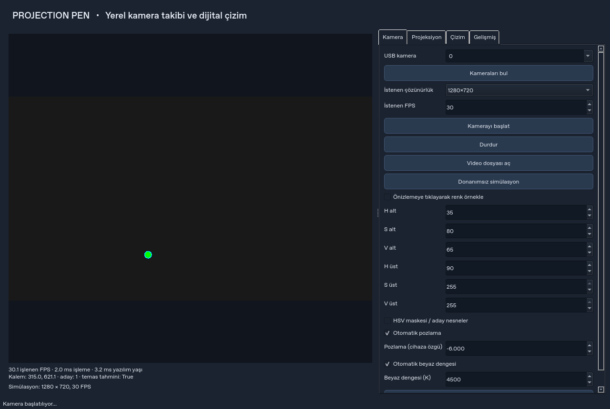

# Projection Pen

USB kamera, renkli işaretleyici ve standart projeksiyon ile çalışan, çevrimdışı masaüstü akıllı tahta uygulaması. Python 3.12+, OpenCV, NumPy ve PySide6 kullanır. Arayüz Türkçedir.

**İlk sürüm:** Kamera takibi → dört noktalı kalibrasyon → projeksiyonda çizim akışı uygulanmıştır. Donanımsız simülasyon ve otomatik testler vardır. Gerçek kamera/projeksiyon hassasiyeti ve Windows/X11 masaüstü davranışı kullanılan donanımda doğrulanmalıdır; 30/60 FPS ve fiziksel temas garantisi verilmez.

## Kurulum

Fedora KDE (sistem Python'unu değiştirmeyin):

```bash
sudo dnf install python3 python3-pip libxcb libxkbcommon-x11 xcb-util-cursor mesa-libEGL mesa-libGL fontconfig libX11
cd projection-pen
python3 --version  # 3.12 veya üzeri
python3 -m venv .venv
source .venv/bin/activate
python -m pip install -e '.[dev]'
projection-pen
```

Windows 10/11, Python 3.12+ (PowerShell):

```powershell
cd projection-pen
py -3.12 -m venv .venv
.\.venv\Scripts\python.exe -m pip install -e ".[dev]"
.\.venv\Scripts\projection-pen.exe
```

PowerShell etkinleştirme politikası değişikliği gerekmez. Windows Ayarlar → Gizlilik ve güvenlik → Kamera → Masaüstü uygulamalarının kameranıza erişmesine izin ver seçeneğini kontrol edin.

Normal kullanım internet, hesap veya API anahtarı gerektirmez. İlk bağımlılık kurulumu paket indirmek için internet ister. OpenCV'nin Qt içeren başka bir dağıtımını aynı sanal ortama kurmayın; bu proje `opencv-contrib-python-headless` kullanır, GUI PySide6 tarafından sağlanır.

## Windows kamera düzeltmesi (0.1.1)

ZIP'i açın, **KUR_WINDOWS.bat** dosyasını bir kez çalıştırın; ardından **BASLAT_WINDOWS.bat** ile açın. Eski sürümün kurulu olması yeni bağımlılığı kurmaz; KUR dosyasını yeniden çalıştırın. Pencere başlığında **0.1.1** görünmeli.

Bağlı kameralar program açılışında adlarıyla listelenir. **Bağlı kameraları yenile** ile USB takıp çıkardıktan sonra listeyi güncelleyin. Yalnız ilk altı indeksin açılmasını deneme yöntemi kaldırıldı. **Kamera yöntemi → Otomatik**, aynı kameranın Media Foundation/DirectShow uçlarını ve istenen biçim çalışmazsa cihaz varsayılanlarını dener. İsterseniz yöntemi elle seçin. Başlatma, yalnız `isOpened()` yerine ilk görüntü karesini de doğrular.

[Kamera görünmüyor / görüntü gelmiyor rehberi](docs/WINDOWS_KAMERA.md)

## Hızlı başlangıç

1. İşletim sisteminde projeksiyonu **genişletilmiş ekran** yapın. Kamerayı tüm yüzeyi görecek şekilde sabitleyin.
2. Yeşil işaretleyiciyi kalem ucuna mümkün olduğunca yakın yerleştirin. Başlangıç mürekkebi kırmızıdır; fiziksel renk ve dijital renk bağımsızdır.
3. Kamera sekmesinde otomatik listelenen kamerayı adıyla seçin (USB/dahili/sanal); çözünürlük ve FPS seçip başlatın. İstenen ve cihazın bildirdiği gerçek değer farklı olabilir.
4. HSV maskesini açın. Gerekirse renk örnekleme kutusunu işaretleyip önizlemede işaretleyicinin ortasına tıklayın. H, S, V sınırlarını ayarlayın. H alt > H üst kırmızı gibi 179/0 sınırını aşan aralıktır.
5. Projeksiyon sekmesinden doğru ekranı seçin; [kalibrasyon rehberini](docs/KALIBRASYON.md) uygulayın.
6. Projeksiyonu tam ekran açın. Çizim sekmesinde **Manuel** modu seçip çizimi etkinleştirin veya **Sürekli** modla test edin.
7. Kalemi hareket ettirin. Fiziksel yüzeyle dijital çizgi hizalanmalı. Kaybolan işaretleyici çizgiyi hemen bitirir.
8. Çizimden oturumu JSON, görüntüyü PNG olarak kaydedin. Şeffaf PNG sadece mürekkebi içerir; hedef, takip imleci ve arka plan dahil edilmez.

Projeksiyon ana ekranı kaplarsa `Alt+Tab` ile kontrol paneline dönün. Normal projeksiyon penceresinde `Esc` gizler. Şeffaf overlay odak almaz; alttaki uygulamanın `Esc` tuşunu engellemez. Paneldeki **Projeksiyonu gizle** düğmesi her zaman kullanılabilir. Program kapatıldığında çizimler otomatik kaydedilmez; **Oturumu kaydet** kullanın.

### Donanım olmadan

```bash
projection-pen --demo
```

Yeşil bir işaretleyici sentetik kamera görüntüsünde hareket eder ve bilinen bir simülasyon dönüşümü kurulur. Projeksiyonu açıp Sürekli modu seçin. Bu dönüşüm fiziksel kalibrasyon değildir. Kamera sekmesindeki **Video dosyası aç** ile kaydedilmiş görüntü işlenebilir; video sonunda çizim durur, otomatik döngü yapılmaz.

```bash
QT_QPA_PLATFORM=offscreen projection-pen --smoke-test
python -m pytest -q
python tools/benchmark.py --width 1280 --height 720 --frames 300
```

Windows için ilk komutun karşılığı:

```powershell
$env:QT_QPA_PLATFORM="offscreen"
.\.venv\Scripts\projection-pen.exe --smoke-test
.\.venv\Scripts\python.exe -m pytest -q
Remove-Item Env:QT_QPA_PLATFORM
```

## Çizim ve görüntüleme

- Fırça rengi ve kalınlığı, silgi, geri al/yinele, temizleme, şeffaf/zeminli PNG ve JSON oturumu desteklenir. Temizleme geri alınmaz ve onay ister.
- Zemin: beyaz, siyah, özel renk, kareli veya çizgili. Görüntü ve PDF dosyaları zemin olarak açılır; PDF sayfası panelden seçilir. PDF şifresi isteme uygulanmamıştır.
- Oturumlar çizgileri, boyutu ve zemin tercihini saklar. Arka plan dosyası **gömülmez**: yolu ve PDF sayfası saklanır. Başka bilgisayarda dosyayı yeniden seçin. Farklı ekran boyutuna yüklemede çizgiler ölçeklenir.
- Çizim renkleri/kalınlıkları projeksiyonun fiziksel piksel uzayındadır. Kamera önizlemesindeki koordinatlar kamera pikselleridir.
- Kalem bulunmadığında, dönüşüm alanı dışında, kamera durunca, kalibrasyon sırasında ve doğrulama sırasında mürekkep üretilmez. Takip için en fazla kayıp süresi sadece nesne kimliğini korur; çizgileri birleştirmez.

### Windows ve X11 üzerinde ekran üstüne çizim

Projeksiyon sekmesinde **Başka uygulamaların üzerine çiz** seçin. Pencere şeffaf, çerçevesiz ve üstte kalma isteğiyle açılır. Fare tıklamaları alttaki sunum/tarayıcı uygulamasına geçer; kamera kalemi çizimi yönetir. Sunumu önce açın, sonra overlay'i açın.

Manuel çizim panel kutusuyla veya global **F8** ile açılıp kapanır. Windows `RegisterHotKey`, X11 `XGrabKey` kullanır. F8 başka uygulama tarafından alınmışsa panelde durum görünür; odak içi F8/panel kutusu kullanılabilir. X11 için `libX11` gerekir. Global F8 yalnız bu uygulamanın çizim kapısını değiştirir; sistem fare hareketi veya tıklaması üretmez.

Bazı tam ekran/özel görüntü modları overlay'i örtebilir; sunumu normal veya kenarlıksız pencere moduna alın. OS masaüstü davranışları ayrıca [sınırlamalarda](docs/SINIRLAMALAR.md) açıklanır.

### KDE Wayland

Uygulama kendi tam ekran tahtasında ve kendi görüntü/PDF zemini üzerinde çizim yapar. Şeffaf pencere seçeneği en iyi çaba olarak açıktır; KWin'in üstte kalma, konumlandırma ve tıklama geçirme kararları her yapılandırmada garanti değildir. Uygulama Wayland altında global F8 kaydetmez; panel kutusu veya uygulama odaktayken F8 kullanılır.

Başka uygulamalara güvenilir overlay gerekiyorsa kurulu bir Plasma X11 oturumunda çalıştırın. Yalnız `QT_QPA_PLATFORM=xcb` ayarlamak tam bir X11 oturumuna geçiş değildir; XWayland'da aynı garantiyi sağlamaz. Güncel Fedora sürümünüz X11 oturumu sunmuyorsa PDF/görüntü alternatifini veya Windows'u kullanın.

## Ayarlar, tanılama ve mimari

Ayarlar Qt'nin uygulama yapılandırma dizininde tutulur; Linux'ta genellikle `~/.config/ProjectionPen/ProjectionPen/settings.json`, Windows'ta kullanıcıya ait AppData yapılandırma dizinidir. Kesin konum `QStandardPaths.AppConfigLocation` ile belirlenir. Kalibrasyon profilleri ayrıca kaydedilip yüklenir. Manuel çizim kapısı ve deneysel mod program açılışında etkinleştirilmez.

Gelişmiş sekmesinde uç ofseti, alan/hız eşikleri, morfoloji, kayıp süresi ve One Euro filtre parametreleri bulunur. Yüksek yumuşatma gecikme ekleyebilir. Varsayılan ofset sabittir; kalem yönü değiştikçe gerçek ucu bulduğu varsayılmaz.

FPS, işleme süresi ve **yazılım yaşı** panelde görünür. Yazılım yaşı, kamera `read()` dönüşünden GUI'ye kadardır; sensör pozlaması, sürücü tamponu ve projeksiyon gecikmesini içermez. Tanılama raporu son 1800 işlenen karenin ölçümlerini, temas hata sayımlarını ve kalibrasyon doğrulamasını kaydeder; kamera görüntüsünü kaydetmez.

`src/projection_pen` içindeki bileşenler:

| Bileşen | Sorumluluk |
| --- | --- |
| `camera` | USB/video/sentetik kaynak, yakalama ve işleme işçileri, tek yuvalı son kare |
| `tracking`, `filters` | HSV, kontur seçimi, nesne ilişkisi, adaptif koordinat filtresi |
| `calibration` | Dört noktalı dönüşüm, ArUco hedefleri, bağımsız hata ölçümü |
| `drawing`, `projection` | Çizgi belgesi, alfa silgi, dışa aktarma, ekran penceresi |
| `controls`, `shortcuts` | Temas deneyi/ölçümleri ve platforma uygun global kontrol |
| `gui`, `settings`, `main` | Kontrol paneli, orkestrasyon, atomik JSON, başlangıç |

Çekirdek takip/kalibrasyon Qt'den bağımsızdır. Bütün çizim işlemleri GUI iş parçacığındadır. Gelecekte IR/ikinci kamera veya anahtarlı kalem için tespit kaynağı ve çizim kapısı ayrı değiştirilebilir.

[Kalibrasyon](docs/KALIBRASYON.md) · [Donanım kabul testi](docs/DONANIM_TESTI.md) · [Sınırlamalar ve gelecek çalışmalar](docs/SINIRLAMALAR.md)

## Arayüz önizlemesi

Aşağıdaki görüntü sentetik kaynakla çalışan gerçek Qt arayüzünden alınmıştır; fiziksel donanım testi değildir.


